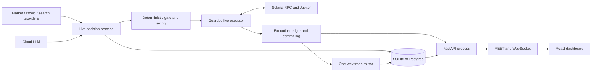
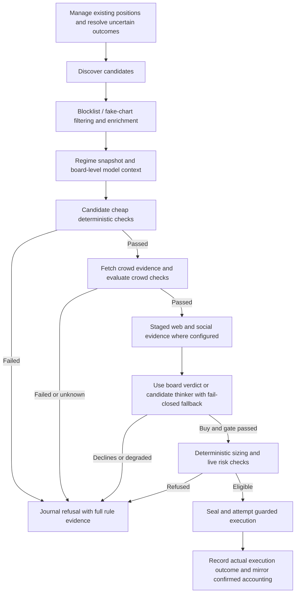

# Application flow

Reviewed against current source on **2026-11-14**. The system has one live
execution book. `DATA_BACKEND=mock` selects fake market input; it does not
change the hardcoded arming flags. See [requirements](REQUIREMENTS.md),
[API contract](API_CONTRACT.md) and [data model](DATA_MODEL.md).

## Process boundaries



The browser never holds the wallet key or initiates a trade. Compose separates
API and live roles using the same image: the API has the live-state mount
read-only and stripped wallet-secret settings. The live process owns signing
and state mutations. Shared decision modules receive callbacks and do not
import live execution. Local API-only development does not require a runner.

## Startup and supervision

1. Configuration loads environment values and source-defined risk constants.
   API startup validates operator credentials; weak configured credentials
   fail startup rather than silently enabling an open endpoint.
2. API lifespan initializes SQL, builds the selected provider/narrator, starts
   the feed broadcaster and heartbeat watcher, then serves the dashboard/API.
3. The separately started live runner initializes its state, wallet and
   reconciliation context, then drives cycles at `TICK_INTERVAL_SECONDS`
   (default 60). A separate exit scanner runs at a source-defined 15 seconds.
4. Heartbeats advance at stage boundaries. Graceful shutdown lets an in-flight
   sign/send/accounting operation finish within the configured stop window.

`start.sh` can start the live process. For development commands that start only
the API, use [DEVELOPMENT.md](DEVELOPMENT.md). Production startup and volumes
are covered in [11_DEPLOYMENT.md](11_DEPLOYMENT.md).

## Candidate-to-decision flow

The orchestration source is [run_live_cycle.py](../backend/run_live_cycle.py);
staged reusable operations live in
[decision_pipeline.py](../backend/decision_pipeline.py).



This is the candidate entry path; board-level LLM work and maintenance can
also run during a tick. Expensive crowd/web/social candidate stages are gated
to conserve quota. A skipped crowd measurement is recorded as not evaluated.
Unknown required evidence fails closed. The regime is retained as context;
the retired regime entry gate must not be inferred from old architecture prose.

When enabled in live-data mode, the board-level brain runs before the per-mint
gate and its validated verdict can be reused. Without that verdict, only
gate-passers receive the candidate thinker call; rule-refused candidates receive
template write-ups. The diagram shows prerequisite authorization, not a claim
that every model call waits for the per-candidate gate.

Entry requires agreement between the deterministic gate and the model's buy
verdict. The model supplies structured judgment and explanation, while code
controls mint identity, amount, position/day caps, stops and execution guards.
Template fallback cannot authorize a buy. A feed approval is journal evidence;
the executor can still refuse due to wallet, risk, quote, simulation or state.

## Eligible decision to actual fill

```mermaid
sequenceDiagram
    participant C as Cycle
    participant E as Executor
    participant L as Commit / execution state
    participant J as Jupiter / RPC
    C->>E: Candidate and deterministic operation
    E->>E: Arming, halt, limits, identity, idempotency checks
    E->>L: Seal canonical intent
    E->>J: Publish and confirm precommit memo
    E->>L: Record memo publication
    E->>J: Obtain quote and swap transaction
    E->>E: Inspect policy and simulate before signing
    E->>L: Persist signed-attempt identity before broadcast
    E->>J: Broadcast and observe signature
    alt Confirmed outcome
        E->>L: Account actual fill exactly once and bind proof
        E-->>C: Confirmed accounting result
    else Unknown outcome
        E->>L: Preserve pending identity for recovery
        E-->>C: Unresolved; no replacement authorization
    else Definitive refusal / failure
        E->>L: Record failure and reason
        E-->>C: Refused / failed
    end
```

The diagram summarizes the money path; individual buy/sell routines own the
exact ordering and durable fields. Before any signing, transaction inspection
enforces allowed operations/programs/accounts and simulation checks the bound
payer and consumed account fields across configured independent RPC results.
Consensus is not blanket equality of every pool byte at different slots.
See [14_SIGNING_GUARD.md](14_SIGNING_GUARD.md) and the
[current consensus scope](18_SECURITY.md#94-simulation-consensus-scope).

## Position management and exit recovery

The cycle and fast scanner use the same serialized management path. They
evaluate stop loss, trailing give-back, liquidity break, invalidation, stale
position and take-profit trims, followed by the applicable sell-risk gate.
Numeric exits do not require a model's permission. Entry budget exhaustion
must not disable de-risking exits.

| Situation | Flow |
|---|---|
| No exit condition | Update relevant observations/high-water memory and continue. |
| Trim/full exit eligible | Build a deterministic sell intent, then apply the live execution guards. |
| Manual kill switch | Block buys and sells until explicit human clearance. |
| Automatic realized-daily-loss trip | Block entries; retain permitted exits. |
| Prior sell signature unresolved | Resolve that attempt first; do not create a replacement sell. |
| Confirmed close already accounted | Settle idempotently without booking proceeds again. |
| State cannot be validated | Refuse mutation; inspect copied state and recovery evidence. |

Confirmed actuals feed the execution ledger, then the SQL mirror, thesis
lifecycle, reflections and learning. The mirror supports dashboard/calibration
queries; it never becomes money authority. Recovery needs positive chain
evidence and the typed operator tooling described in [OPERATIONS.md](OPERATIONS.md).

## Dashboard journey

1. The SPA opens the live view, starts REST reads and hydrates 50 recent feed
   events before following `/ws/feed`. Events merge by ID, newest first,
   capped at 200. Reconnection uses exponential backoff capped at 15 seconds
   and rehydrates REST history.
2. A protected read returning 403 opens the operator login overlay. The current
   form exchanges the token for an HttpOnly cookie and reloads after success.
   It does not persist credentials in browser storage or implement CAPTCHA
   solving; see [authentication contract](API_CONTRACT.md#authentication-endpoints).
3. The user navigates live, holdings, journal, market and system tabs. The
   command palette, filters, keyboard shortcuts and mint-history drill-down
   navigate/read data; they never place, close or arm trades.
4. Mint drill-down loads the per-mint paginated history. Escape first collapses
   expanded content, then backs out of the drill-down/help hierarchy.
5. Failed reads retain available previous data and show an error state. Unknown
   marks/cash remain unavailable. An empty book, disconnected feed, disarmed
   book and stale engine are distinct states.

| Read | Current refresh interval |
|---|---|
| Live portfolio | 5 seconds |
| Live executions | 10 seconds |
| Regime, system status, stats, funnel, safety | 15 seconds |
| Funnel snapshots | 60 seconds |
| Decision tape | REST hydration plus WebSocket pushes |

The generic REST hook permits one request at a time and aborts after 15
seconds. [App.tsx](../frontend/src/App.tsx) is the source for refresh schedules;
[frontend design](../frontend/DESIGN.md) defines presentation states. API
liveness, a connected WebSocket and engine trading progress are independent.
