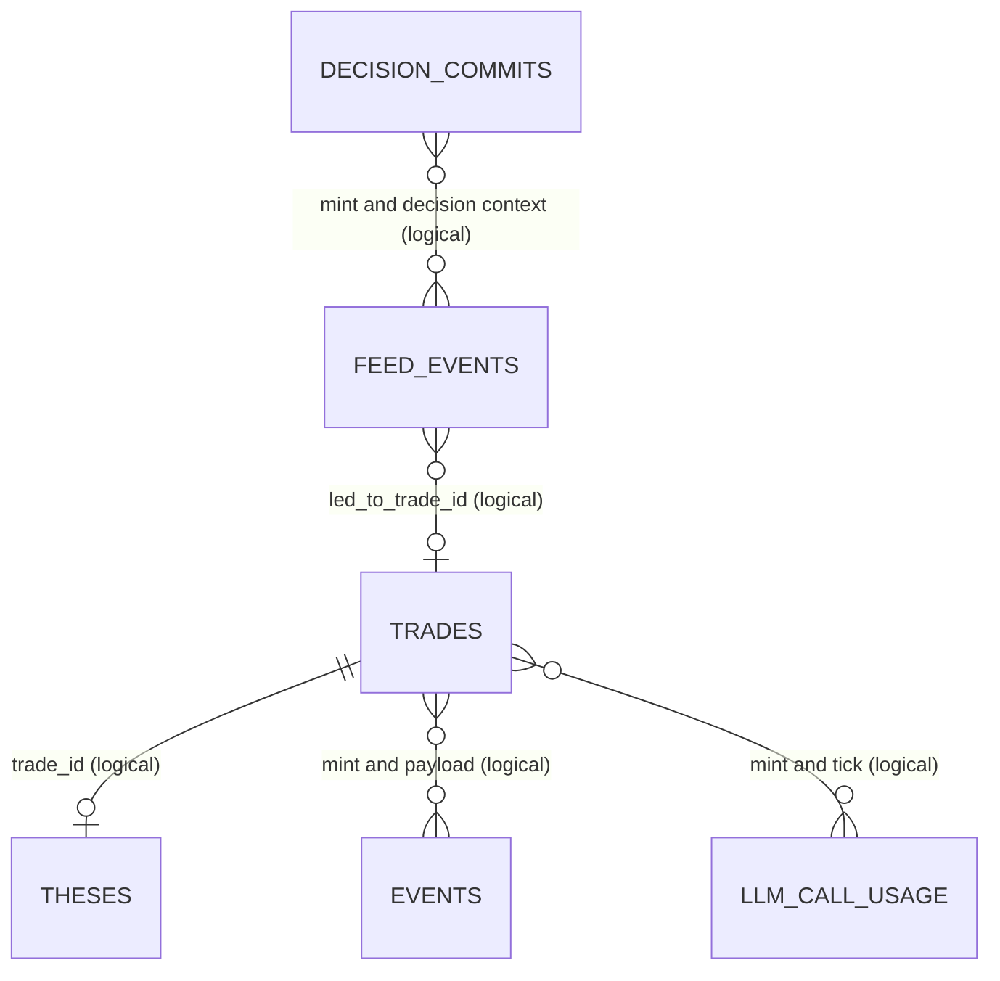
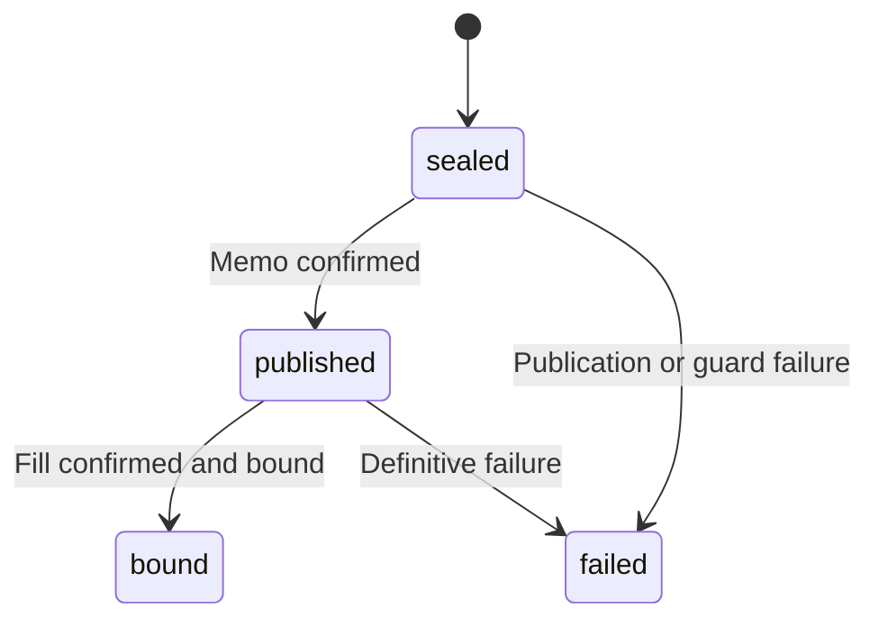

# Data model

Reviewed **2026-11-14** against [models.py](../backend/models.py),
[SQLite schema](../backend/api/db.py), [Postgres repository](../backend/api/db_pg.py),
and [live models](../backend/live_execution/models.py).
See the [API contract](API_CONTRACT.md) for wire semantics.

## Authorities and representations

| Store | Authority | Readers / writers |
|---|---|---|
| Solana chain | Actual balances, transaction confirmation and token decimals | Live executor and read paths query RPC. |
| `executions.json` | Local execution accounting, remaining cost basis and idempotency | Live ledger methods; API reads the state volume read-only in Compose. |
| `commits.json` | Sealed live order intents, memo/fill binding and pending sell attempts | Live commit-log methods and explicit recovery tools. |
| SQLite or Supabase | Queryable feed, mirrored trades, theses, learning and proof records | Engine writes observations/mirror; API reads and performs authorized maintenance/ingestion. |
| Other state files | Kill switch, breaks, blocklist, budgets, telemetry and session revocation | Each control's owning module; paths depend on service role. |

The SQL `trades` table is a **one-way mirror** of live execution accounting.
It is not an alternative wallet or an authorization to trade. The legacy
`portfolio_state.cash_usd` row and `INITIAL_CASH_USD` support historical math;
current spendable cash comes from the wallet's USDC balance.

## In-memory domain records

| Type | Identity / principal fields | Meaning |
|---|---|---|
| `Candidate` | `mint_address`, `symbol`, price/liquidity/volume/cap, decimals, market/security/crowd/social evidence, `source`, `discovery_source` | Snapshot of provider observations; a mint identifies an asset, a symbol does not. |
| `SecurityInfo` | Mint/freeze authority and honeypot observations | Optional security evidence. |
| `RuleResult` | `rule_id`, `passed`, `detail`, `value`, `evaluated` | Deterministic check with measured/unknown/skipped distinction. |
| `GateDecision` | Candidate, full rule list, `all_passed`, failed and not-evaluated IDs | Aggregate rule result, independent of a model verdict. |
| `FeedEvent` | SQL-assigned `id`, timestamp, snapshot, verdict, rules, thesis, provenance, optional trade link | One published candidate decision. |
| `Trade` | Generated `trade_id`, mint, entry/cost/quantity, lifecycle, HWM, trims, thesis/reflection | Queryable mirrored position lifecycle. |
| `PortfolioState` | `cash_usd`, open positions | Snapshot used by gate/sizing. |
| `DailyStats` | UTC date, counts, statistics dictionary | Learning/summary record. |

Optional candidate measurements use `None` for missing data. In particular,
unknown decimals must never become a guessed default. `evaluated=false` is
separate from a rule whose measured result fails. Lists/dictionaries are
serialized at repository boundaries; callers should use repository helpers.

## SQL entities

The current SQLite schema has the following 13 application tables. JSON below
means JSON-encoded TEXT in SQLite; Postgres uses its dialect-specific types
and conversions. Inspect migration SQL for exact Postgres column definitions.

| Table | Key | Significant columns | Purpose / invariants |
|---|---|---|---|
| `feed_events` | Integer `id` | `ts`, mint/symbol, `candidate_snapshot`, `verdict`, `thesis`, `rule_breakdown`, `failed_rule_ids`, `regime_ok`, `grounding_flags`, `narration_source`, `led_to_trade_id`, model/prompt versions, `risk_flags` | Verdict constrained to `pass`/`fail`; complete rule evidence survives refusals. |
| `trades` | TEXT `trade_id` | Mint/symbol, opened/closed times, entry/exit prices, `position_size_usd`, `quantity`, snapshot, thesis, reason, realized P&L, `is_open`, `high_water_usd`, `tranches_taken`, reflection | Unique partial index permits at most one open position per mint. Closed histories can share a mint. |
| `market_regime` | Integer `id` | `computed_at`, candidate count, green percentage, median volume, buy/sell ratio, `regime_ok`, detail | Tick-level market context; boolean constrained in SQLite. |
| `provider_call_counters` | (`provider`,`day`) | Calls, errors, 429 count, last-call time | UTC daily provider usage. |
| `kb_documents` | Integer `id`; unique `filename` | Content, digest, `ingested_at` | Ingested research and generated digest; public index omits body. |
| `daily_stats` | UTC `date` | Open/closed counts, `stats_json` | Persisted learning summaries. |
| `decision_commits` | Integer `id`; unique `payload_hash` | Created/tick times, mint/symbol, verdict, `entry_allowed`, nonce, `payload_json`, hash, fill signature/phase/match method, memo signature/slot, venue, model/prompt versions | SQL decision-proof record, distinct from live `commits.json`. |
| `llm_call_usage` | Integer `id` | Task/provider/model, tick/mint, status, latency, token counts, cost estimate, peak-window flag, degradation reason | Usage observations, not provider billing truth. |
| `events` | Integer `id` | UTC time, `kind`, mint/symbol, `payload_json` | Durable event stream; kind constrained to `thought`, `did`, `refused`, `read`, `trade`. |
| `memories` | Integer `id` | Topic, note, weight, hits, `updated_at` | Weighted lessons recalled by thinker. |
| `portfolio_state` | Integer `id`, constrained to 1 | Historical cash, `updated_at` | Legacy singleton; never current live cash authority. |
| `theses` | TEXT `trade_id` | Mint/symbol, author, thesis, created/updated/closed times, realized P&L | Durable current write-up and close outcome. |
| `funnel_snapshots` | Integer `id` | UTC time, seen/refused/passed/approved/filled counts, model refusal rate | Engine-written observation history; zero gate-passers yields null rate. |

### Logical relationships

These are application relationships, **not declared SQLite foreign keys**.
Several decisions can concern the same mint, and a passing feed row can lack
a filled trade. Do not join on symbol or assume every decision has a fill.
Use trade IDs and exact commit/signature binding when available. Retroactive
attribution is labeled separately (`matched_by`) and is not equivalent to an
exact decision-time association.

Indexes cover feed timestamps/IDs, open/closed trades, regime times, commit
times/signatures, LLM usage times, event kind/time, memory topic/weight,
thesis mint and funnel timestamps. They support bounded dashboard queries;
there is no implemented warehouse or unrestricted report API.

## Live execution files

### `ExecutionRecord` and `executions.json`

The ledger is a validated JSON list of records, not a SQL table. Fields include:

| Fields | Semantics |
|---|---|
| `kind` | `buy` or `close`. |
| `idempotency_key` | Buy identity; close accounting also uses transaction-signature identity to prevent double reductions. |
| `mint`, `usd_size`, `tokens_out`, `price_usd` | Buy cost / close proceeds and fill measurements, interpreted by record kind. |
| `signature`, `status`, `blockhash`, `ts` | Chain identity, lifecycle and Unix timestamp. Status vocabulary includes `recorded`, `sent`, `confirmed`, `pending`, `failed`, `closed`. |
| `pnl_usd`, `rule_id` | Realized close result and triggering exit rule where available. |
| `commit_hash`, `commit_nonce`, `commit_payload`, `commit_sealed_at` | Decision provenance. |
| `memo_signature`, `memo_slot`, `reason` | Precommit publication and diagnostic context. |

Ledger methods derive open exposure, remaining tokens/cost, daily deployment,
realized daily P&L, trim counts and close timing. Close/partial-close methods
must update accounting exactly once. Replacing malformed history with an
empty list is prohibited by validation. Writes use serialized mutation and
atomic replacement; use the owning methods rather than editing JSON.

### Live intent lifecycle and uncertain outcomes

[CommitLog](../backend/live_execution/commit_log.py) stores `kind` (`buy`/`sell`),
nonce, payload, SHA-256 hash, sealing time, memo fields, fill signature and
status. Normal lifecycle:

The seal hashes the nonce, a literal `|`, and the canonical payload produced
by the implementation. Verification must use the same serialization; altering
JSON whitespace can alter a hash. A published memo alone is not a trade.

Pending buys and signed sell attempts retain identity until reconciled.
Sell-attempt status (`pending`/`confirmed`/`failed`) is **separate** from the
commit's lifecycle; attempts also preserve signature/blockhash/signing time
and attempt history. An unknown outcome is not a failed transaction and must
not authorize another sell. Delayed/contradictory observations require the
recovery rules in [operations](OPERATIONS.md).

`PendingConfirmation` records bind human approval to the canonical operation.
Approval follows `pending → approved → consumed`; denial or expiry prevents
consumption, and an approval can expire before use. Legacy or mismatched
approval cannot authorize a different side, mint or size.

## Other durable state

| File / category | Purpose | Caveat |
|---|---|---|
| `kill_switch.json`, `break_state.json` | Manual/automatic halt and entry breaks | Manual kill blocks all trades; the daily-loss automatic trip permits exits. |
| `blocklist_state.json` | Loss memory, mint cooldown/auto-block | Resolve to a persistent writable path. |
| `spend_guard.json` / API-specific spend file | Daily LLM/search reservations | A restart must not reset budget; API and live service have separate files in Compose. |
| `session_revocations.json` | Revoked session signature and expiry | Stored under API writable data, not the read-only live-state mount. |
| `safety_counters.json` | Guard/simulation refusal telemetry | Diagnostic; not trade authority. |
| `consensus_counters.json` | Private live-process buy/sell consensus attempt/refusal counts | Reset per live-process restart; includes `written_at`/`since_boot_at`, not exposed by health. |
| `heartbeat.txt` | Engine liveness timestamp | API liveness does not establish engine liveness. |
| Encrypted FOMO sidecar and secret-store key | Refresh-token persistence | Secret material; excluded from normal state backups. |

Path defaults differ between local runs and containers. See
[CONFIGURATION.md](CONFIGURATION.md) and the
[runtime write-path inventory](10_SECURITY.md#1b-runtime-write-paths).

## Database evolution and retention

- SQLite `init_db()` creates tables/indexes and attempts idempotent additive
  column migrations for older books. It is not a general migration framework.
- Supabase requires **all `001`–`007` migrations in order** from
  [migrations/supabase](../migrations/supabase/). Do not stop at `006`:
  `007_revoke_anon_authenticated.sql` revokes public API roles' table/sequence
  privileges and checks RLS. The backend uses its privileged connection;
  dashboard users do not access Postgres directly.
- Migration `006` adds user-linked columns/policies and migration tracking on
  Postgres. Those columns do not turn this into a supported multi-user app,
  and are not present in the SQLite application schema.
- Pytest forces SQLite; parity tests inspect repository surfaces and SQL, but
  they do not prove a real hosted Postgres migration succeeded.
- Feed/regime pruning is explicit maintenance using configured keep counts.
  Do not infer indefinite retention or hard-delete execution authority when
  pruning SQL observations.
- Back up and validate copied state before upgrade/restore. Current backups
  use the v2 scrypt/AES-256-GCM envelope; restore accepts legacy Fernet archives.
  SQLite files, JSON authority and remote Postgres require appropriate separate
  recovery treatment. See [OPERATIONS.md](OPERATIONS.md).
